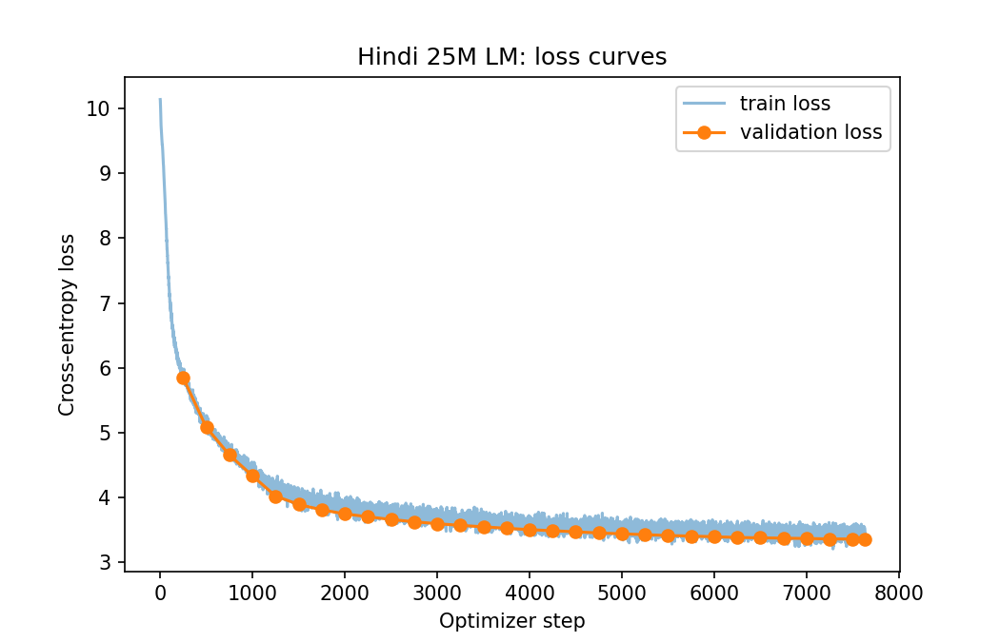

# Building and Analyzing a Monolingual Transformer LM for Hindi

Language Models and Agents, Monsoon 2026, individual project. Code, configs and results are in this repository;
checkpoints are on Google Drive (link in the README).

## 0. Scope and deviations from the handout

| Handout requirement | What was done |
|---|---|
| Two models (higher- and lower-resource) | **One model, Hindi only.** There is no Model L, so the resource-tier comparison in Section 8 is replaced by the analyses that a single model allows. |
| At least 20% of training tokens collected manually | **0% manual.** All text comes from public Kaggle corpora. |
| ~500M training tokens | 500,000,033 train tokens (met). |
| ~25M-parameter decoder-only Transformer from scratch | 25,383,552 parameters (met). No pretrained models, tokenizers, `nn.Transformer*`, or `scaled_dot_product_attention`. |
| Phase deadlines and per-phase branches | Not followed, by agreement of the author; all work is on `main`. |
| Optional no-positional-embedding ablation | Not run (the model has a `use_pos_emb` flag, so it is a configuration change plus a retraining). |

## 1. Data (Section 1 of the handout)

**Sources (Kaggle):** Hindi OSCAR (`hi_dedup.txt`, 9.5 GB, 11.47M lines), a Hindi news summarization corpus (`train.csv`
and `test.csv`, 180k articles) and BBC Hindi articles (4.6k).

**Cleaning** (`hindi/data/preprocess.py`): NFC normalization; removal of URLs, control and zero-width characters; whitespace
collapsing; drop documents shorter than 50 characters, under 80% Devanagari, over 10% Latin letters, or containing
legacy-font mojibake (a Latin letter inside a Devanagari word); exact deduplication across all sources.

| Source | Read | Kept | Short | Low Devanagari | Too much Latin | Mojibake | Exact duplicate |
|---|---|---|---|---|---|---|---|
| OSCAR | 11,469,844 | 10,192,373 | 550 | 976,788 | 279,434 | 2,541 | 18,158 |
| News | 179,835 | 147,383 | 1,137 | 21,147 | 3,602 | 10 | 6,556 |
| BBC | 4,598 | 3,840 | 3 | 0 | 0 | 1 | 754 |

**Corpus build** (`hindi/data/build_corpus.py`): the splits are by document hash (99 / 0.5 / 0.5), so no document is in
two splits. OSCAR was subsampled at random to 48%. MinHash near-duplicate removal (5-word shingles, 128 hashes, 8 bands
of 16 rows, roughly Jaccard 0.85) was applied, with validation and test processed first so that train documents
near-duplicating them are dropped. About 53.7k train documents were removed as near-duplicates. Output: `uint16` token
shards with an end-of-text token after each document.

| Split | Tokens | Composition |
|---|---|---|
| Train | 500,000,033 | OSCAR 77.5%, news 21.6%, BBC 1.0% |
| Validation | 4,795,705 | about 89% OSCAR by tokens |
| Test | 4,808,583 | about 89% OSCAR by tokens |

Full tables: `report/dataset_stats.md`. **Quality caveats:** only near-duplicates above about 0.85 similarity are removed;
OSCAR is web text with residual noise; validation and test are mostly web text, so the reported perplexity describes
web Hindi, not news or literature.

## 2. Tokenizer

SentencePiece BPE, trained from scratch on sentences from the train split only (OSCAR 4%, news 25%, BBC 100%), with byte
fallback, digit splitting and no normalization (text is already NFC). Evaluated on 20,000 validation documents:

| Vocabulary | Characters per token | Tokens per word | Unknown rate | Byte-fallback rate |
|---|---|---|---|---|
| 16k | 3.91 | 1.293 | 0% | 0.59% |
| **24k (chosen)** | 4.04 | 1.250 | 0% | 0.61% |
| 32k | 4.12 | 1.227 | 0% | 0.62% |

**Choice:** 32k saves under 2% of tokens relative to 24k but costs about 3M more embedding parameters in a 25M model. The unknown rate is
0% only because of byte fallback; the byte-fallback rate (0.6%) is the real measure of unseen characters. Token
frequencies follow a Zipf-like curve (`report/tokenizer_rank_frequency.png`); 96% of the vocabulary is used on
held-out text. Files: `hindi/tokenizer/models/hindi_bpe_*.model` and `.vocab`.

## 3. Model (Section 2.1 of the handout)

Code: `hindi/model/transformer.py` (181 lines), built from `nn.Linear`, `nn.Embedding`, `nn.LayerNorm` and
`nn.Dropout` only. Configuration: `hindi/configs/hindi_25m.json`.

| Setting | Value |
|---|---|
| Parameters | **25,383,552** (embedding table 24,000 x 384 = 9.2M, shared with the output head) |
| d_model / layers / heads / d_k | 384 / 9 / 6 / 64 |
| Feed-forward | 384 -> 1536 -> 384, GELU |
| Context length | 512 |
| Normalization | pre-norm LayerNorm, plus a final LayerNorm |
| Positions | learned absolute embeddings |
| Dropout | 0.05 (embeddings, attention probabilities, sublayer outputs) |

**What each part does, and why it was chosen**
- **Token and positional embeddings.** Attention is permutation-invariant, so position must be injected. Learned absolute
  positions are simple and fast; the cost is a hard limit: no embedding exists beyond position 511, so the model cannot be
  run on longer inputs without retraining or interpolation.
- **Causal self-attention.** `qkv = Linear(d, 3d)` produces Q, K, V (identical to three d x d projections). Each of
  shape (B, T, d) is reshaped to (B, h, T, d_k). Scores are `QK^T / sqrt(d_k)`: for unit-variance entries the dot
  product has variance d_k, so without the scaling the softmax saturates and gradients vanish. An additive mask `M`
  (0 on and below the diagonal, -1e9 above) is added before the softmax, computed in fp32. The weighted values are
  concatenated back to (B, T, d) and projected by W_O.
- **Causality is tested:** changing token t+1 leaves the logits at positions up to t exactly unchanged (maximum
  difference 0.0, `hindi/model/test_model.py`), while later positions do change. The test also checks that attention rows sum
  to 1 with zeros above the diagonal.
- **Pre-norm blocks** (`x + Attn(LN(x))`, `x + MLP(LN(x))`) keep an unnormalized residual path from input to output, which makes
  deep stacks easier to optimize than post-norm.
- **Tied embeddings** save 9.2M parameters (one third of the model). A 24k vocabulary makes the table large relative to
  25M, which is also why 32k was rejected.
- **Depth versus width.** With 9.2M parameters in the table, about 16M remain for nine blocks of 1.77M each. A 500M-token
  budget is about 20 tokens per parameter, roughly compute-optimal for a single pass, so no regularization beyond
  dropout 0.05 was needed.
- **Initialization:** normal(0, 0.02), with residual-output projections scaled by `1/sqrt(2 * layers)`.

## 4. Pretraining (Section 2.2)

AdamW (betas 0.9 / 0.95, weight decay 0.1 on matrices only), 400-step linear warmup then cosine decay from 6e-4 to 6e-5,
gradient clipping 1.0, 65,536 tokens per step (32 x 4 x 512), 7,630 steps (about one epoch), fp16 autocast with a gradient
scaler on a Kaggle T4, about 4.3 hours at 31-34k tokens/s. Checkpoints hold weights, optimizer, scaler, step, RNG state,
config and loss history; an interrupted-then-resumed run reproduces an uninterrupted run exactly
(`hindi/train/test_resume.py`). One early mistake worth reporting: the first launch used emulated bf16 on the T4 and ran
at 2k tokens/s; switching to fp16 gave a speedup of about 14x.

*The plotted validation loss uses the first 3,200 validation windows, which contain a larger share of news and BBC text
than the full set, so it sits below the full-validation value in Section 5.*

## 5. Language-model evaluation (Section 2.3)

Computed on the full validation and test splits in non-overlapping 512-token windows
(`hindi/eval/lm_eval.py`). Bits-per-byte divides the summed negative log-likelihood in bits by the UTF-8 bytes of the
target text (about 10.2 bytes per token).

| Split | Cross-entropy (nats/token) | Perplexity | Bits per byte |
|---|---|---|---|
| Validation | 3.6304 | 37.73 | 0.5122 |
| Test | 3.6311 | 37.75 | 0.5132 |

Validation and test agree closely, so there is no sign of tuning on the validation set.

**Generation quality** (`hindi/eval/gen_eval.py`): 500 held-out prefixes of 64 tokens, continuations of up to 64 tokens,
scored against the true continuation. BLEU-4 and chrF++ via `sacrebleu` (the danda is split from words); ROUGE-L F1 is
implemented in the repository.

| Decoding | BLEU-4 | chrF++ | ROUGE-L | Distinct-1 | Distinct-2 | 4-gram repetition | Avg. length (tokens) |
|---|---|---|---|---|---|---|---|
| Greedy | 2.65 | 10.9 | 11.5 | 0.10 | 0.26 | 55% | 34.6 |
| T = 0.5 | 3.11 | 13.0 | 12.5 | 0.14 | 0.43 | 22% | 34.4 |
| T = 1.0 | 2.43 | 15.9 | 11.6 | 0.24 | 0.74 | 1.0% | 50.5 |
| T = 1.5 | 0.81 | 14.5 | 6.2 | 0.39 | 0.96 | 0.05% | 60.0 |

**How informative are these metrics?** Open-ended continuation has many valid continuations, so overlap with the single
reference is a weak signal for any model, and low absolute values are expected. BLEU-4 needs exact 4-gram matches and is
the harshest; chrF++ rewards partial character overlap and is the most forgiving for a morphologically rich language;
ROUGE-L rewards word order only. The ranking differs by metric (BLEU and ROUGE-L peak at T = 0.5, chrF++ at T = 1.0),
which shows the metrics are measuring different things. Distinct-n and repetition measure diversity, not quality: they
improve monotonically with temperature while overlap collapses at T = 1.5. Generated continuations also stop early
(about 34 tokens at greedy and T = 0.5 versus 64 in the reference) when the model emits its end-of-text token, which further lowers overlap
scores through length mismatch.

**Qualitative observations** (`report/pretrain/gen_samples.md`): at low temperature the text is locally grammatical Hindi
(correct postpositions, verb endings and punctuation) and stays on the prompt's topic, but greedy decoding falls into loops
("अपने को ही अपने को ही ..."), and moderate-temperature samples repeat names ("कपिल शर्मा कपिल शर्मा") and drift
semantically within a sentence or two. At T = 1.5 the text is varied but increasingly incoherent. This is the
expected profile for a 25M-parameter model with a 512-token window. *(These notes are the report author's reading of the
sample file and should be checked by a fluent reader.)*

## 6. Attention analysis (Section 2.3 and 3.2)

Code: `hindi/eval/attn_analysis.py`. For each head, entropy is the mean over query positions of the entropy of its
attention distribution (nats; higher means more diffuse; uniform causal attention over 256 tokens gives about 4.5), and mean
attention distance is the average of `i - j` weighted by attention (in tokens; uniform gives about 64 for 256 tokens).
Heads with mean distance under 5 tokens are called local. An untrained model gives exactly the uniform values, which is
the baseline.

**Held-out web text (32 sequences of 256 tokens):**

| Layer | 0 | 1 | 2 | 3 | 4 | 5 | 6 | 7 | 8 |
|---|---|---|---|---|---|---|---|---|---|
| Entropy, pretrained | 4.19 | 3.42 | 2.80 | 2.54 | **1.91** | 1.94 | 2.52 | 3.10 | 3.23 |
| Distance, pretrained | 58.2 | 35.4 | 17.5 | 13.4 | **18.9** | 25.8 | 40.1 | 54.0 | 60.7 |
| Entropy, finetuned | 4.40 | 3.78 | 3.39 | 3.11 | 2.61 | 2.40 | 3.16 | 3.36 | 3.46 |
| Distance, finetuned | 60.1 | 47.1 | 29.7 | 29.9 | 33.4 | 42.5 | 47.0 | 51.1 | 63.1 |

Pretrained structure: layer 0 is nearly uniform (it mixes broad context), the middle layers (3-5) are the most focused,
and the last layers diffuse again. 6 of 54 heads are local.

**Reasoning prompts (64 prompts from `test_iid`):**

| Layer | 0 | 1 | 2 | 3 | 4 | 5 | 6 | 7 | 8 |
|---|---|---|---|---|---|---|---|---|---|
| Entropy, pretrained | 3.14 | 2.87 | 2.47 | 2.26 | 1.78 | 1.96 | 2.24 | 2.35 | 2.34 |
| Entropy, finetuned | 3.20 | 2.64 | 2.29 | **1.69** | **1.18** | **1.21** | **1.57** | **1.93** | **1.91** |
| Distance, pretrained | 18.4 | 14.1 | 8.9 | 7.9 | 8.7 | 12.3 | 16.5 | 20.1 | 20.2 |
| Distance, finetuned | 19.9 | 14.3 | 8.6 | 6.6 | 7.6 | 11.3 | 15.4 | 17.7 | 19.6 |

Local heads on reasoning prompts: 8 of 54 pretrained, 6 of 54 finetuned.

**Findings**
1. **Finetuning specializes attention for the task.** On reasoning prompts the middle and late layers become much
   sharper (for example layer 4: 1.78 to 1.18 nats) while layer 0 is unchanged; mean distances stay short, so the
   change is in focus, not in range.
2. **The same finetuning degrades general text behaviour.** On web text the finetuned model has no local heads and higher
   entropy at every layer. The finetuned model has drifted away from the language-modeling solution. (The first
   finetuning attempt, with a much smaller name pool, drifted further: web-text entropy of 3.2-4.4 across layers.)
3. **Head types.** Layers 3-5 hold the local, positional heads (short distance, low entropy); layer 0 and the last layers
   hold diffuse, content-mixing heads. In the finetuned reasoning heatmap
   (`report/attn/finetuned_reasoning_heatmap_s0.png`), layer-4 heads show sharp near-diagonal bands, while layer-8 heads 1-3 show diagonal stripes
   offset from the main diagonal in the reasoning segment. A plausible reading is that these look back at matching tokens
   in the question (name copying). *This is an interpretation of the figure; it was not verified by ablating heads.*
   Heatmap token labels are crowded for sequences of about 100 tokens.

Figures: `report/attn/` (`*_heatmap_s*.png` for web text, `*_reasoning_heatmap_s*.png` for reasoning prompts, `*_entropy.png`,
`*_distance.png`, and the matching `*_reasoning_*` grids).

## 7. Reasoning finetuning (Section 3.1)

**Dataset** (`hindi/reasoning/generate.py`, deterministic): Hindi comparative and transitive-reasoning problems whose
answers are known by construction. Tasks: ordering from 3 or 4 shuffled pairwise statements ("राम सीता से लंबा है। सीता गीता से
लंबा है।"), and comparison of 2 or 3 stated numbers (height, age, weight, speed, price). Questions are superlative,
pair, or yes/no. Each example has a short reasoning line (the ordering) and then the answer. Adjectives agree with the
subject's gender and masculine item nouns take the oblique form before postpositions. Splits: train 60,000,
validation 1,000, `test_iid` 1,500, `test_ood` 1,500; all 64,000 prompts are unique.

**Leakage control:** person and item names are disjoint across train, validation and test. Training uses about 1,460
person names (60 real, 1,400 made-up) plus 26 item words, so that the model must copy names rather than memorize them.
Made-up names are 2.3-2.5 tokens long on average (real names: 1.0-1.1), so copying them is harder than copying real names. `test_ood` also uses statement and question
templates never seen in training.

**Protocol:** finetune from the pretrained checkpoint, tokenizer fixed, AdamW lr 3e-4 with cosine decay, batch 32,
4 epochs (7,500 steps, about 28 minutes), loss on the reasoning and answer tokens only. Evaluation: greedy decoding,
exact match on the text after "उत्तर:". Random-guess accuracy computed from the gold answers is **40%** overall
(35% superlative, 48% pair, 50% yes/no).

| Split | Overall (chance 40%) | Superlative (35%) | Pair (48%) | Yes/no (50%) | Reasoning line exact | Name copy rate |
|---|---|---|---|---|---|---|
| Pretrained, zero-shot (all splits) | 0.0% | 0.0% | 0.0% | 0.0% | 0.0% | 0.0% |
| Validation, finetuned | 45.6% | 43.8% | 42.6% | 50.2% | 11.5% | 55.8% |
| `test_iid`, finetuned | **51.1%** | 50.6% | 54.8% | 51.2% | 19.7% | 54.3% |
| `test_ood`, finetuned | **31.3%** | 21.2% | 39.8% | 49.4% | 7.1% | 51.7% |

By task, `test_iid` versus `test_ood`: chain3 52.5% vs **16.8%**, chain4 49.3% vs **20.3%**, num2 53.3% vs 48.3%,
num3 49.1% vs 39.7%. Chance for chain3 / chain4 superlatives is 33% / 25%.

**Error analysis**
- **The model has learned the answer format and some template-specific cues, not transferable transitive reasoning.**
  In distribution it is about 11 points above chance overall; yes/no questions stay at chance (about 50%) on every split.
- **Name copying is unreliable.** The answer name appears in the question only about 54% of the time. Examples from
  `test_iid`: the prompt contained "दतोवा", the model wrote "दूहवा"; another reasoning line contained "जोहान", which was not in
  the prompt; others contain fragments such as "धिकारियों". Most names in the data are made-up and take 2.3-2.5 tokens (real names take 1.0-1.1), and the model garbles multi-token names. This
  is partly a consequence of the dataset design, not only of model capability. In some yes/no examples the final answer is consistent with the model's own (wrong) ordering line, so a
  wrong ordering produces a wrong answer.
- **New phrasings break the chain tasks.** On `test_ood` the chain tasks fall to 17-20%, below chance, because the
  model matches the surface forms of the two training statement templates; the numeric tasks, whose fact sentence is
  unchanged, degrade much less.
- **Iteration history.** The first dataset used only about 55 names; finetuned accuracy was 15% overall and exactly 0%
  on name-answer questions (`report/reasoning/v1_old_dataset/`). Widening the name pool is what moved superlative
  accuracy from 0% to 51%, showing that name copying was the main bottleneck of the first attempt.

## 8. Answers to the handout's final questions, adapted to one language

1. **Data scale and quality.** 500M tokens after cleaning, of which 77.5% is OSCAR web text and 21.6% news. About 11% of OSCAR
   lines and 14% of news articles were discarded as non-Hindi or code-mixed, and 53.7k train documents as
   near-duplicates. No manual data. Quality limits: residual web noise and a validation set that is mostly web text. No second
   language means no resource-tier comparison.
2. **Language-modeling versus reasoning results.** Language modeling works at this scale (perplexity 37.7, 0.51 bits per
   byte, fluent local text, repetition under greedy decoding). Reasoning works far less well: 51% against 40% chance in
   distribution and below chance on new templates. A 25M-parameter model with 60k finetuning examples fits the training
   distribution but does not acquire the transferable ordering procedure.
3. **Tokenizer and corpus factors.** The 24k vocabulary averages 1.25 tokens per word on held-out text, but the made-up names in the reasoning data
   take 2.3-2.5 tokens each (real names: 1.0-1.1), and the model's difficulty copying multi-token names accurately is the main
   cause of the first attempt's failure and a major source of the remaining errors. A larger name pool in the finetuning data reduced this effect substantially but did not remove it. On the
   corpus side, near-duplicate removal and the subsampling of OSCAR shaped the training mix.
4. **Evidence.** Section 5 (perplexity and generation metrics), Section 6 (attention structure and its change under
   finetuning), and Section 7 (accuracy by task, name copy rate, v1 versus v2 comparison, in-distribution versus new-template
   results).

## 9. Limitations

- One language, 0% manual data, a single pretraining run and a single finetuning seed per condition; no confidence intervals.
- Near-duplicate removal covers only roughly 0.85 Jaccard similarity and above.
- Validation and test are about 90% web text; the training-log validation curve covers a news-heavier subset.
- Generation metrics use a single reference; the held-out windows begin and end mid-sentence.
- The reasoning dataset is synthetic with narrow phrasing; native-speaker review of the templates was not done. Most of its names are made-up and
  multi-token, which makes copying harder than with real names and probably lowers accuracy relative to a real-name dataset.
- Attention interpretations (local versus content heads, copy-like stripes) are descriptive and were not tested by head
  ablation.
- Finetuning used a single learning rate (3e-4), which may be too high (web-text attention drifts); learning-rate and
  answer-only (`--no-cot`) ablations were not run.
- The optional no-positional-embedding ablation was not run.

## 10. Reproducibility

Commands for every step, the Kaggle notebooks used, and the Drive links for the checkpoints are in `README.md`.
Hyperparameters are stored with every checkpoint (`config.json`, the checkpoint's `config` field).

## 11. Use of AI tools

The code, experiments and this report were developed with the assistance of an AI coding assistant (Claude Code). Under the
course policy, the author must be able to explain every component of the submitted code; the explanations of attention,
masking, normalization, tying and the training loop above are written to support that.
